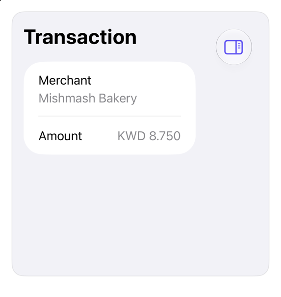

# SweetUI 🍭

<p align="center">
  <a href="https://github.com/mangobyte-dev/sweetui/actions/workflows/ci.yml"></a>
  <a href="https://github.com/mangobyte-dev/sweetui/releases/latest"></a>
  
  
  <a href="#quickstart"></a>
  <a href="https://sweetui.dev"></a>
  <a href="LICENSE"></a>
</p>

<p align="center"><b>Beautiful SwiftUI you copy in and own.</b><br>Theme once, install with one command, keep Apple's controls at the call site.</p>

Native-first SwiftUI components and registry: copy in, own (shadcn/ui spirit). Swift source, metadata, not framework. Theme once, search, inspect, copy, customize, audit. Apple controls stay visible at the call site

### One modifier, seven themes

`.registryTheme(.indigo)` at the scene root restyles every item. Captures follow your GitHub light or dark mode

<table>
  <tr>
    <td align="center"><picture><source media="(prefers-color-scheme: dark)" srcset="docs/images/themes/system-dark.png"></picture><br><code>.system</code></td>
    <td align="center"><picture><source media="(prefers-color-scheme: dark)" srcset="docs/images/themes/graphite-dark.png"></picture><br><code>.graphite</code></td>
    <td align="center"><picture><source media="(prefers-color-scheme: dark)" srcset="docs/images/themes/indigo-dark.png"></picture><br><code>.indigo</code></td>
    <td align="center"><picture><source media="(prefers-color-scheme: dark)" srcset="docs/images/themes/rose-dark.png"></picture><br><code>.rose</code></td>
    <td align="center"><picture><source media="(prefers-color-scheme: dark)" srcset="docs/images/themes/emerald-dark.png"></picture><br><code>.emerald</code></td>
    <td align="center"><picture><source media="(prefers-color-scheme: dark)" srcset="docs/images/themes/amber-dark.png"></picture><br><code>.amber</code></td>
    <td align="center"><picture><source media="(prefers-color-scheme: dark)" srcset="docs/images/themes/mango-dark.png"></picture><br><code>.mango</code></td>
  </tr>
</table>

### Blocks: whole screens, one install

<table>
  <tr>
    <td align="center"><picture><source media="(prefers-color-scheme: dark)" srcset="docs/images/items/finance-overview-dark.png"></picture><br><code>finance-overview</code></td>
    <td align="center"><picture><source media="(prefers-color-scheme: dark)" srcset="docs/images/items/nutrition-overview-dark.png"></picture><br><code>nutrition-overview</code></td>
    <td align="center"><picture><source media="(prefers-color-scheme: dark)" srcset="docs/images/items/activity-feed-dark.png"></picture><br><code>activity-feed</code></td>
  </tr>
  <tr>
    <td align="center"><picture><source media="(prefers-color-scheme: dark)" srcset="docs/images/items/message-scroller-dark.png"></picture><br><code>message-scroller</code></td>
    <td align="center"><picture><source media="(prefers-color-scheme: dark)" srcset="docs/images/items/signup-form-dark.png"></picture><br><code>signup-form</code></td>
    <td align="center"><picture><source media="(prefers-color-scheme: dark)" srcset="docs/images/items/questionnaire-dark.png"></picture><br><code>questionnaire</code></td>
  </tr>
  <tr>
    <td align="center"><picture><source media="(prefers-color-scheme: dark)" srcset="docs/images/items/dashboard-dark.png"></picture><br><code>dashboard</code></td>
    <td align="center"><picture><source media="(prefers-color-scheme: dark)" srcset="docs/images/items/calendar-dark.png"></picture><br><code>calendar</code></td>
    <td align="center"><picture><source media="(prefers-color-scheme: dark)" srcset="docs/images/items/chart-dark.png"></picture><br><code>chart</code></td>
  </tr>
</table>

### Components: native controls, themed

<table>
  <tr>
    <td align="center"><picture><source media="(prefers-color-scheme: dark)" srcset="docs/images/items/button-dark.png"></picture><br><code>button</code></td>
    <td align="center"><picture><source media="(prefers-color-scheme: dark)" srcset="docs/images/items/input-otp-dark.png"></picture><br><code>input-otp</code></td>
    <td align="center"><picture><source media="(prefers-color-scheme: dark)" srcset="docs/images/items/avatar-dark.png"></picture><br><code>avatar</code></td>
  </tr>
  <tr>
    <td align="center"><picture><source media="(prefers-color-scheme: dark)" srcset="docs/images/items/toast-dark.png"></picture><br><code>toast</code></td>
    <td align="center"><picture><source media="(prefers-color-scheme: dark)" srcset="docs/images/items/alert-dark.png"></picture><br><code>alert</code></td>
    <td align="center"><picture><source media="(prefers-color-scheme: dark)" srcset="docs/images/items/metric-card-dark.png"></picture><br><code>metric-card</code></td>
  </tr>
  <tr>
    <td align="center"><picture><source media="(prefers-color-scheme: dark)" srcset="docs/images/items/slider-dark.png"></picture><br><code>slider</code></td>
    <td align="center"><picture><source media="(prefers-color-scheme: dark)" srcset="docs/images/items/macro-progress-dark.png"></picture><br><code>macro-progress</code></td>
    <td align="center"><picture><source media="(prefers-color-scheme: dark)" srcset="docs/images/items/fold-companion-dark.png"></picture><br><code>fold-companion</code> (iPhone Duo)</td>
  </tr>
</table>

Every item, in light and dark, with its install command: [catalog](docs/catalog/index.md) and [sweetui.dev](https://sweetui.dev)

### Tune on device, ship the code

<table>
  <tr>
    <td width="260"></td>
    <td>Add <code>SweetUIDesignSurface</code> and a debug build gets a Tune button. Select any item on screen, move the sliders, then <b>Copy Swift</b> to paste a <code>RegistryTheme(...)</code> back into your app. Release builds stay unchanged. Details: <a href="#tune-on-device">Tune on device</a></td>
  </tr>
</table>

### Built by agents

Four apps an agent built from the registry alone. Screens, commands and every friction point it hit: [case studies](docs/case-studies.md)

<table>
  <tr>
    <td align="center"><br>Chat</td>
    <td align="center"><br>Finance</td>
    <td align="center"><br>Settings</td>
    <td align="center"><br>Shop</td>
  </tr>
</table>

Browse 3 ways:

- Website (`Website/`, Next.js, shadcn/ui): preview, install command, usage, source. Live: `sweetui.dev`. Deploy: `cd Website && npm run deploy`; local: `npm ci && npm run dev`
- Showcase app (`Examples/Showcase/SweetUIShowcase.xcworkspace`): Components/Blocks/Recipes tabs, live demos, design surface, tokens to controls
- Markdown [catalog](docs/catalog/index.md)

Four small apps an agent built from the registry, with screenshots and the friction it met: [case studies](docs/case-studies.md)

## Quickstart

Every command is real; `sweetui describe <item>` prints usage snippet

1. Add package:

   ```swift
   dependencies: [
       .package(url: "https://github.com/mangobyte-dev/sweetui.git", .upToNextMinor(from: "0.5.0"))
   ],
   // In your target's dependencies:
   .product(name: "SweetUIFoundations", package: "sweetui")
   ```

   Xcode: Add Package Dependency, Up to Next Minor from 0.5.0, `SweetUIFoundations`

2. Theme once, scene root:

   ```swift
   import SweetUIFoundations

   ContentView()
       .registryTheme(.graphite)
   ```

   Controls follow tint. Presets: `.system` (app tint), `.graphite`, `.indigo`, `.rose`, `.emerald`, `.amber`, `.mango` (sample, [MANGO](docs/mango.md)). Custom: Tune panel / `designSurface()`, move sliders, Copy Swift exports `RegistryTheme(...)`

3. Install via Homebrew, anywhere:

   ```sh
   brew install mangobyte-dev/tap/sweetui
   sweetui install button --destination Sources/App/Components
   ```

   Copies `RegistryButtonStyle.swift`, writes `.sweetui/receipt.json`, prints requirement: `from 0.5.0 up to the next minor version`. Fetches the pinned release tag's snapshot, caches under `~/Library/Caches/sweetui`; `--refresh` refetches. From clone: `swift run sweetui <command>`

4. Use it:

   ```swift
   Button("Save changes") {}
       .buttonStyle(.registry)

   Button("Cancel") {}
       .buttonStyle(.registryOutline)
   ```

5. Tune on device: add `SweetUIDesignSurface`, apply `designSurface()` inside theme call:

   ```swift
   import SweetUIDesignSurface

   ContentView()
       .designSurface()
       .registryTheme(.graphite)
   ```

   Debug build: draggable Tune button. Tap Select, item, to scope. Copy Swift pastes `RegistryTheme(...)` into step 2. Release build unchanged

## Taxonomy

3 item kinds, 1 validator:

- `component`: installable style, modifier, composition: reusable treatment, native control (`button`, `input`, `card`, `avatar`)
- `block`: installable, architecture-neutral composition, components (`auth-form`, `activity-feed`)
- `recipe`: native guidance, one-line Apple API as treatment (`switch`, `sheet`, `context-menu`); nothing installs

Value gate: installable items MUST add meaningful treatment beyond native API; mere renames become recipes (`docs/registry-spec.md`)

Search: local, deterministic, JSON-first; filters `--platform`/`--target-version`; no model, MCP, account, hosted-registry needed. Results: dependency closure, requirements, accessibility, preview paths, compatibility metadata

## Install, update

```sh
sweetui install finance-overview --destination path/to/YourTarget/Components
```

Resolves closure (`metric-card`, `transaction-row`, `empty` before `finance-overview`), copies source, writes `.sweetui/receipt.json`, non-Swift base snapshots. Never edits project files; destination: build-target member. Repeats need matching receipts; modified source: `--force`. Only `--refresh` touches cache. Post-install: daily tap check flags upgrades; silent failure. `--registry /path/to/clone` serves checkout

Verify: `xcodebuild -scheme YourApp -destination 'generic/platform=iOS Simulator' build`

```sh
sweetui search activity --kind block --format names
sweetui install activity-feed --destination path/to/YourTarget/Components --plan
```

Update source, content-based:

```sh
sweetui install finance-overview \
  --destination path/to/YourTarget/Components \
  --update
```

- Unmodified source: registry version
- Local-only edits: stay
- Disjoint edits: merged via `git merge-file`
- Overlapping edits: owned source kept, `.merge` emitted under `.sweetui/conflicts/`

## Agent workflow

Read-only flags preview/audit before touching destination; recipes: guidance only, never install

```sh
sweetui install finance-overview --destination path/to/YourTarget/Components --plan
```

`--plan`: dependency closure (versions/kinds), write status (`new`/`up-to-date`/`modified-would-require-force`/`would-merge`), requirements, collisions, manual steps

```sh
sweetui install finance-overview --destination path/to/YourTarget/Components --diff
```

`--diff`: diff per receipt-backed file vs canonical, exit 0 identical / 1 different. Needs receipt

```sh
sweetui describe activity-feed
```

`describe`: name/kind/version/description/usage/accessibility; installables add closure, requirements, file targets. `--source` appends content; `--format json` matches MCP's `describe_item`

```sh
sweetui info --destination path/to/YourTarget/Components
```

`info`: destination receipt, files up-to-date/modified/missing, summary count. Never touches registry; exits 2, no receipt

### MCP server

`sweetui mcp` exposes search/describe/plan/diff/install/preset tools over stdio:

```json
{
  "mcpServers": {
    "sweetui": {
      "command": "sweetui",
      "args": ["mcp"]
    }
  }
}
```

`"--registry", "/path/to/clone"` serves checkout. Read-only tools carry `readOnlyHint`; `install_item` carries `destructiveHint`

## Compose

```swift
ActivityFeed(
    "Activity",
    notice: ActivityNotice("Card delivery delayed", message: Text("Arrives Thursday.")),
    onDismissNotice: { },
    items: items,
    earlierItems: earlier,
    isLoading: isLoading,
    onSelect: onSelect
)
```

Block: presentation. Caller: value prep, localization, navigation, state, persistence, scrolling, container width

## Tune on device

`designSurface()`: registry theme under tuning, persisted as `registry-tokens.json`. 2 arguments extend:

```swift
ContentView()
    .designSurface(
        tokens: MyTokens.self,
        knobs: ["button": [ItemKnob("padding", in: 0...32, shipped: 12)]]
    )
    .registryTheme(.app)
```

`MyTokens`: `TokenDocument`, shipped value, file name, `.number`/`.choice`/`.color` knob pages, `apply()` called on change. Item reads knob via `environment.registryKnob("button", "padding", default: 12)`. `designSurface(isPresented:)`: app owns trigger

Own-token: host overload, always compiles:

```swift
ContentView()
    .designSurface(
        enabled: designMode,
        tunesRegistryTheme: false,
        itemTitle: { name in MyPieces.title(for: name) },
        page: { name in MyPieces.page(for: name) },
        panelEnvironment: { panel in panel.environment(\.myTokens, tokens) }
    ) { chain in
        MyPanelSections(chain: chain)
    }
    .registryTheme(myTheme)
```

`enabled`: app's switch; `tunesRegistryTheme: false` drops theme sections. `panel`: app sections under selection. `page`: matching page. `panelEnvironment`: stack reading app environment. `itemTitle` names rows/outlines. `chain`: tagged items under last pick, innermost first. Screens self-name via `registryScreen(_:)`; items carry `registryItem(_:)`, tag Select resolves

## Why use registry?

Same todo/counter app, 3 UI layers, 1 TCA core in `Examples/TodoCounter`: installed items, stock SwiftUI, hand-rewritten design. `-ui plain`/`-ui handmade` launch alternatives; registry is default

Measured 2026-09-06, iPhone 17 simulator, iOS 27. Lines via `Examples/TodoCounter/count-lines.py` (non-blank/comment; installed includes previews)

| | Registry | Stock | Handmade |
| --- | --- | --- | --- |
| |  |  |  |
| Written | 223 in 4 files | 154 in 3 files | 585 in 11 files |
| Owned | 651 in 7 installed items | 0 | 0 |
| Implements | none | none | `ButtonStyle`, `TextFieldStyle` (`_body`), `GroupBoxStyle`, `ToggleStyle`, 3 `ViewModifiers`, environment key, theme: 8 colors, 9 metrics |
| Look | themed coral, preset code | stock controls | same design; byte-identical capture |
| Accent | 1 value: `RegistryTheme+App.swift` / new preset | not available | 1 value, once plumbing exists |
| Updates | `--update` merges upstream, keeps edits | nothing to update | port every change by hand |
| Accessibility | required labels for icon-only controls, 44pt hit sizes, text-scaling boxes, VoiceOver switch, RTL/Dynamic Type previews | whatever stock gives | know, rewrite it |
| Launch (`XCTApplicationLaunchMetric`, 5 runs) | 2.97s | 2.99s | 2.98s |
| 5 tasks add/complete/clear (`XCTClockMetric`, 3 runs) | 9.17s | 15.59s | 9.16s |
| Skills | SwiftUI, 1 command | SwiftUI | protocols, environment plumbing, Dynamic Type, accessibility, dark-mode, RTL |

Runtime cost: none vs hand-written styles (2 rows: noise). Stock's slower interaction: UI-automation, not rendering. Registry buys 585 lines, skills, update path. Tests: [README](Examples/TodoCounter/README.md)

## Status

Version 0, honest prototype:

- Items generate into `docs/catalog/`, website data; counts there
- `SweetUIFoundations`: pre-1.0 package (accent, on-accent, surface, border, positive, negative, disabled-opacity, metrics). 7 presets, 1 root modifier
- `SweetUIDesignSurface`: second product, own window, movable-resizable panel, per-item knobs, own-token-document page. Persists as `registry-tokens.json`, exports preset code any tool applies
- Every item: versioned JSON metadata (dependencies, SwiftPM requirements, platforms, accessibility notes, previews, usage). 1 validator checks all, captured screenshots
- Installer writes exact-content receipts, performs conflict-aware three-way updates
- Showcase compiles installables, recipes at iOS 26 floor. Pins visual contract checks for blocks, runs accessibility-audited demo walk per item
- Published: `0.1.0` (2026-09-06), `0.2.0` (2026-09-07) as tags/GitHub releases, shipping universal `swiftui-registry` binary (`sweetui` from 0.5.0), Homebrew tap `mangobyte-dev/tap`. `0.3.0`: design-surface's public beta. `0.3.1`: exports reproduce the panel; recipes are selectable. `0.4.0`: `validated-input`, the case studies, search words and API fixes from the agent study. `0.5.0`: the project renamed SweetUI (`sweetui` tool and formula, `SweetUIFoundations`, `sweetui.dev`). `0.5.1`: visual references and the UI-test scroll helper. `0.6.0`: iPhone Duo support (`fold-companion`, `fold-arrangement`). Not yet: hosted registry, Xcode-project mutation, platforms beyond iOS. Known limitations: `CHANGELOG.md`

## Requirements

- Swift tools 6.2+
- iOS 26+
- Xcode building Swift 6.2 packages
- Homebrew (`brew install mangobyte-dev/tap/sweetui`), clone
- Node 22: website, codec check inside `swift test`
- Python 3: `Scripts/capture_previews.py`
- Git: three-way merge update

Verified: Xcode 27.0, Swift 6.4. Items inherit Liquid Glass natively, carry no pre-26 styling, avoid 27-only APIs

## Verify

```sh
swift run sweetui validate
swift run sweetui generate catalog
swift run sweetui generate showcase-manifest
swift run sweetui generate site-data
swift run sweetui generate item-tokens
swift test
xcodebuildmcp simulator test \
  --workspace-path Examples/Showcase/SweetUIShowcase.xcworkspace \
  --scheme SweetUIShowcase \
  --simulator-id YOUR_IOS_27_IPHONE_SIMULATOR_ID
```

Simulator suite verifies:

- Demo block behavior: focus order, disabled states, validation copy, bindings, placeholder states, accordion, notice dismissal
- Empty state, accessibility-size typography, RTL mirroring, tuning export, visual references

Baseline: `docs/visual-testing.md`. Screenshots: `python3 Scripts/capture_previews.py`

## Sample app

```sh
open Examples/Showcase/SweetUIShowcase.xcworkspace
```

Select `SweetUIShowcase`, run; each item shows install command, usage. Source under `Examples/Showcase/SweetUIShowcasePackage/Sources/SweetUIShowcaseFeature/Installed/`

Second consumer, `Examples/TodoCounter/TodoCounter.xcworkspace`: built 2026-09-06 from fresh Xcode project, proves any-architecture support. Drives todo list, Point-Free's counter. Package: GitHub, `0.1.0` tag; 7 items via Homebrew. Theme: preset code, customized. 1 component: receipt-tracked local edit. README: all commands

## Read next

- [Website](Website/)
- [Catalog](docs/catalog/index.md)
- [Philosophy](docs/philosophy.md)
- [Architecture](docs/architecture.md)
- [Changelog](CHANGELOG.md)
- [Spec](docs/registry-spec.md)
- [Testing](docs/visual-testing.md)
- [MANGO](docs/mango.md)
- [Agent skills](Skills/)
- [Contributing](CONTRIBUTING.md)

## Deliberate boundaries

No package-dependency additions; no macOS, watchOS, tvOS, visionOS, or physical-device claims. Focus: product composition, source ownership, deterministic discovery, safe updates

## Security, conduct

Report vulnerabilities privately per [Security](SECURITY.md); MUST NOT: public issue. Conduct: [rules](CODE_OF_CONDUCT.md). CI runs registry gate, website build with production dependency audit, secret scan on every push/PR

## License

MIT
