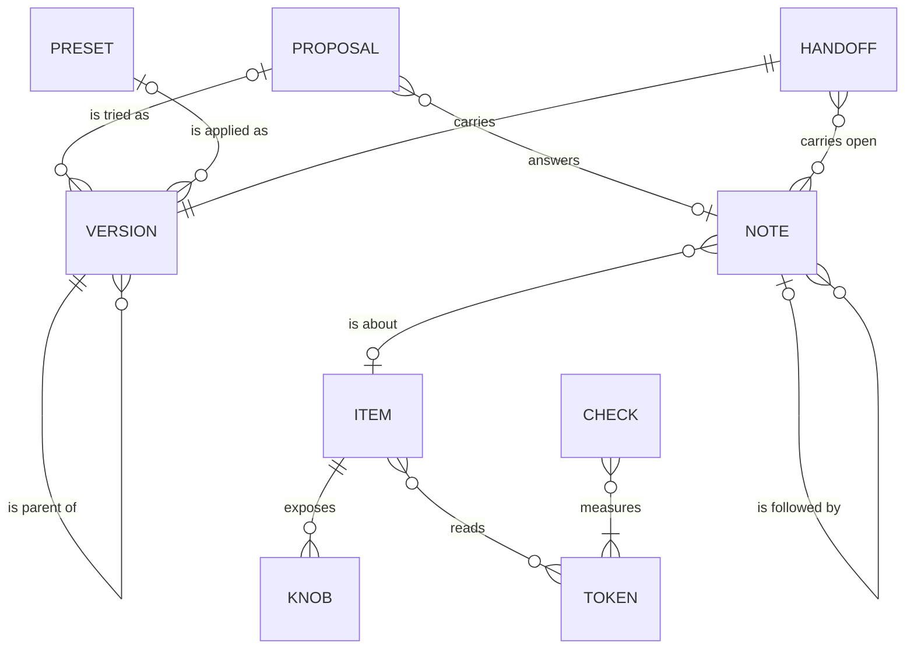
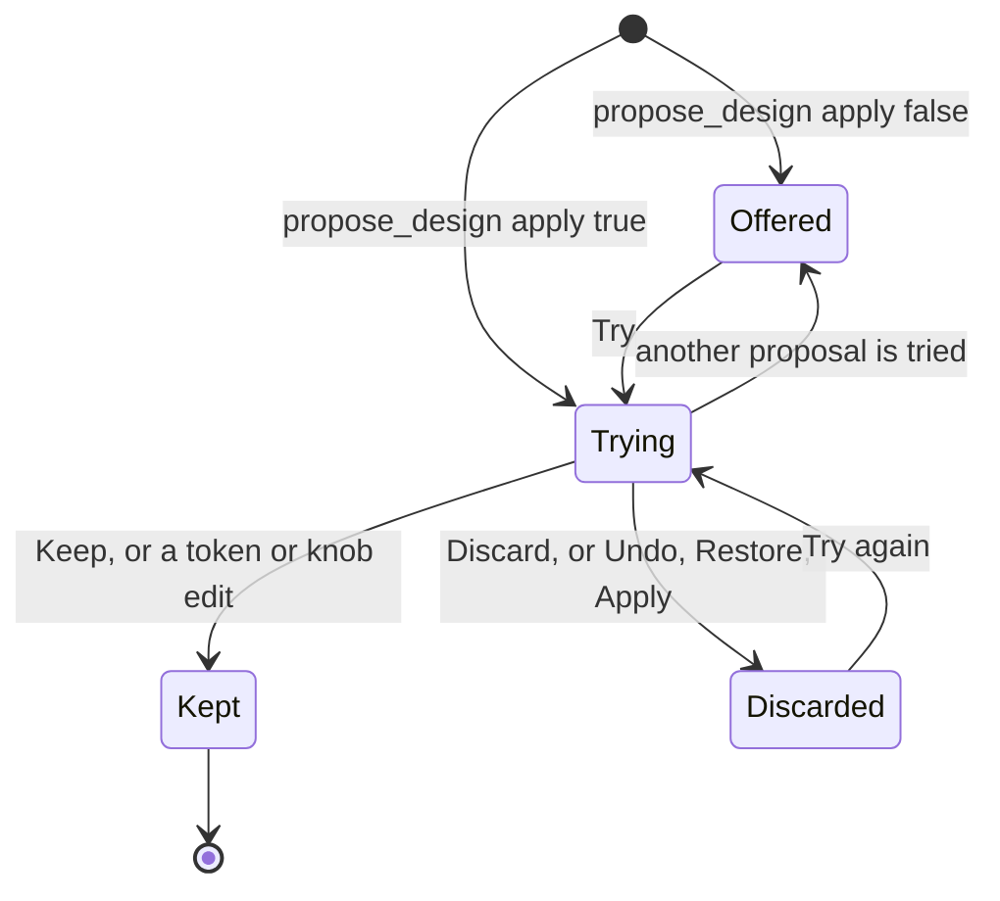
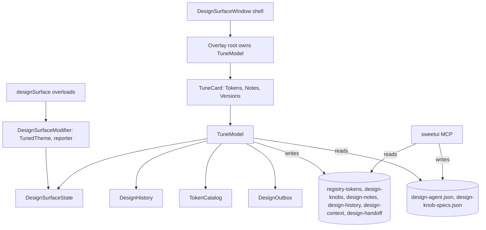

# Tune: the design surface contract

Tune is the floating card `designSurface()` puts over a running debug build. This file is the
contract for its model, its places, its files, and the agent tools that close the loop. It was
designed bottom-up through the Layers method (layers.jamiemill.com): conceptual model first,
then interaction structure, then surface. `docs/architecture.md` says where the product sits;
`CHANGELOG.md` says what shipped. Decisions here win over older prose elsewhere.

## Thesis

Tune is one design on the device, three places, and one conversation with the agent. The running
app is the canvas and the selection is the lens: select an item and every place follows it.
**Tokens** holds every value the design reads. **Notes** holds every word between the person and
the agent, including the agent's proposals. **Versions** holds every state the device showed, who
made it, what it came from, and the hand-off to source. Each file has one writer, the panel or the
agent, so a write is never lost. Tune paints nothing until a token is set: the app's own source
theme shows through, and a hand-off the agent answers with changed files clears Tune's overrides
so the source shows again. Every message gets an answer, every change names its author, and
Keep, Discard, Undo and the composer sit at the bottom of the card, in thumb reach.

## Glossary

One name per concept, one concept per name. Copy, identifiers, doc comments, and MCP descriptions
use these words and no retired ones (`VocabularyTests` enforces it).

| Term | Means | Replaces |
| --- | --- | --- |
| Tune | the product: button, card, places | design surface panel, Tuning panel, Tune panel |
| Item | a registry item on screen, by registry name; the host may title it | piece, Picked, component (in copy) |
| Instance | one occurrence of an item on screen | row |
| Screen | the named screen under the card | screen meaning screenshot |
| Screenshot | a PNG under `notes/` | Capture the screen |
| Selection | the item the places follow; none means the screen | scope, Selected item, All tokens |
| Select | arm a tap on the app to choose an item | pick, Point |
| Token | a theme value (or a host app value) with a key, a title, a group, a kind | knob for a theme field, tuning field |
| Group | Color, Type, Space, Shape, Surface, Chart, Disabled | the old section names |
| Mode | Light or Dark value of a color token | the separate Dark controls |
| Knob | an item property the host or the agent declared: number, switch, choice | a piece's knobs |
| Design | the theme code plus every knob value; empty means Source | state, tuning as the whole |
| Version | a design that was on the device, with author, origin, parent, optional name; "design version" in MCP descriptions, since items have semver versions | state, entry, checkpoint |
| Current | the version on the device now | cursor |
| Author | you or the agent | source |
| Default | `ThemeTuning.default`, the values Changes compare against | shipped (when it meant the default), Reset |
| Source | the app's own compiled theme, what shows while Tune sets no token | |
| Shipped | a hand-off the agent answered with changed files; Tune then clears to Source | |
| Preset | a SweetUI theme preset (name, code) | |
| Code | a preset code | `--preset` text |
| Apply | make a preset, Default, Source, or a pasted code the current version | Import, Reset |
| Restore | make a past version current, deleting nothing | tap a history row |
| Undo / Redo | parent / newest child of Current | the banner's Undo |
| Note | what the person says about an item or the screen, with a screenshot | comment, Notes for the agent |
| Subject | the item or screen a note is about | About |
| Reply | a note that follows another | Reopen |
| Answer | the agent's reply to a note or a hand-off, with changed files | reply, resolved |
| Read / Not read yet | whether the agent listed the note after it was sent | |
| Proposal | a design the agent offers: Offered, Trying, Kept, Discarded | variant, agent change, From the agent |
| Try | put a proposal on the device as a version by the agent | chip tap |
| Keep / Discard | decide a trying proposal | Keep, Dismiss, chosen, the banner's Undo |
| Hand-off | the current design and the open notes, sent to the agent for source | Send to agent, Export |
| Preview | appearance, text size, direction, outlines, guides; applied beside the theme, never part of a version | Environment, the button's hold menu |
| Check | a contrast pair with light and dark ratios and a verdict | Contrast row |
| Changes | token and knob differences in words, from and to | differences, a code in a banner |

Retired words that fail `VocabularyTests` in copy and descriptions: piece, Picked, checkpoint,
states as a count, variant (the `registryVariant` API excluded), resolved, Reopen, Dismiss,
Send to agent, Export, Capture the screen, Tuning panel, Tune panel, design surface panel,
shipped theme, and knob applied to a theme field.

## Objects

| Object | Attributes | Relationships | Actions | Lifecycle | Backed by |
| --- | --- | --- | --- | --- | --- |
| Version | id, date, design, author, origin (first, edit, preset, proposal, Default, Shipped, code), name, parent; derived: label, changes, contrast | 1 Current per device; 0..1 parent, 0..* children; 0..1 origin proposal or preset; a hand-off carries 1 | Undo, Redo, Restore, Name, Copy code, Copy Swift, Hand off | current or past; named or not | `design-history.json` (panel); the current values in `registry-tokens.json` and `design-knobs.json` (panel) |
| Proposal | id, date, name, reason, note, tokens as a delta (or a full code when the agent sent one), knobs with null for default, apply; derived: state, changes | answers 0..1 note; tried as 0..* versions; at most 1 Trying, its version a child of the base | Propose (agent), Try, Try again, Keep, Discard, Reply | Offered, Trying, Kept, Discarded; Discard also from Offered; Keep discards the Offered siblings, the proposals that answer the same note, and a proposal that answers no note has none, so Keep never turns down an unrelated loose proposal; the device shows the decided design or exactly one proposal on top; the tree decides the state: Redo or Restore onto a proposal's version re-enters Trying, Undo past a kept one records Discarded, Undo right after Restore onto one that is not kept returns to the version Restore left and records it Discarded | `design-agent.json` (agent); trial and decisions (tried, kept, discarded) in `design-history.json` (panel) |
| Note | id, created, text, subject (item and chain, or screen), tokens, knobs, frame, code, screenshot, inReplyTo (a note or a proposal); derived: read, answer | about 0..1 item; on 1 version; follows 0..1 note or proposal; 0..1 answer; answered by 0..* proposals; open notes travel with the next hand-off | Send, Reply (on every note and proposal row), Delete, Select its item; Answer and Read (agent) | Not read yet, Read (the agent listed this note's id), Answered | `design-notes.json`, `notes/<id>.png` (panel); answers and readAt in `design-agent.json` (agent) |
| Hand-off | id, sent at, design, Swift, changes from Default, open notes, screenshot; derived: answer | carries 1 version and 0..* open notes; the current one and the previous one accept answers | Hand off (keeps a trying proposal first); Read and Answer (agent) | Not read yet, Read, Shipped (answer with files: Tune clears its token and knob overrides so the source shows), Answered (reply only) | `design-handoff.json`, `notes/handoff.png` (panel); answer in `design-agent.json`; Shipped in `design-history.json` |
| Item | name, title, instances with frames, screen, chain | on 1 screen; inside 0..1 item; reads 0..* tokens; exposes 0..* knobs; subject of 0..* notes; 0..1 is the Selection | Select, Select container, Clear selection, Note about it, Copy name | on or off screen; selected or not | derived: reporter frames, `RegistryItemTokens`, `KnobStore`; the agent's copy is `design-context.json` |
| Token | key, title, group or host page, kind (number, choice, color with modes, accent), default, value; derived: reach | valued by every version; reaches 0..* items; measured by checks; an app token belongs to a host page and sits outside versions | Set, Set the Dark value, Use the Light value, Reset token, Reset app tokens | default or changed | `registry-tokens.json` (panel); the host's `TokenDocument` file; catalog in `TokenCatalog.swift` |
| Knob | name, title, kind (number, switch, choice), range or options, default, value, declared by host or agent | belongs to 1 item; valued by every version | Set, Reset knobs | default or changed; not drawable (shown with the reason) | values in `design-knobs.json` (panel); declarations in `ItemKnob` and `design-knob-specs.json` (agent, by hand) |
| Check | pair, ratios in light, dark, Increase Contrast, verdict | measures 2 tokens in both modes on Current | Fix label, Ask the agent | passes, passes with Increase Contrast, fails, not measurable | derived by `ContrastAudit` |
| Preset | name, code | applied as 0..* versions | Apply | matches Current or not | `RegistryTheme.presets` |

Proposal lifecycle:

## Places

Place / affordance → destination / [content]. The shell is not a place; Selecting is a mode.

### Shell

[drag bar: grab, Collapse] [toolbar: Select; item menu label, "Home · 6 items" or "Card in Grid";
at accessibility sizes, or in a card too short for the picker, the place Menu] [place picker:
Tokens, Notes with the count of new answers and proposals, Versions] [the place] [bottom, in
`safeAreaInset`: the Trying strip while a proposal is trying, "Trying Warm. Accent, Card radius."
with Keep and Discard; the bottom bar: Undo, Redo, Preview showing its active overrides, Note]
[card closed: the Tune button with a badge for new agent activity]

- Tune button → the card at the remembered place (Tokens on first open)
- Drag bar, grip → same place, card moved, resized, or snapped to the iPad column (PanelGeometry kept)
- Collapse → card closed; a held edit settles first
- Select → Selecting
- Item menu > an item, or a container in its chain → that item selected; from Tokens or Versions the card shows Tokens, from Notes it stays on Notes with the item as the composer's subject
- Item menu > Clear selection → same place, nothing selected
- Place picker → Tokens, Notes, or Versions; a held edit settles first
- Undo → the parent version current (while trying: Discard); Redo → the newest child current
- Preview → one menu with inline pickers: Appearance (System, Light, Dark), Text size, Direction (System, Left to right, Right to left), and toggles Outlines and Guides; 2 taps per override; applied beside the theme, also when `tunesRegistryTheme` is false; the card keeps the system direction
- Note → Notes, composer focused, subject = the selection or the screen; with nothing selected it arms Selecting first and returns to the focused composer with the tapped item as subject
- Select with VoiceOver running → the item menu opens instead of the capture layer
- Strip > Keep → "Kept Warm." for 2 s; Strip > Discard → the base version current, "Discarded Warm."; Strip > the name → Notes, scrolled to that proposal

Edges: no items on screen ("Home · no items", the menu explains `registryItem(_:)`); no named
screen ("This screen · 4 items"); the selected item on another screen ("Card is not on this
screen" in the label; the composer falls back to the screen until a new selection); Undo or Redo
at an end disabled with a hint naming the target; Undo right after Restore returns to the version
that was current before it; `tunesRegistryTheme: false` keeps Versions for knob-only designs and
hides Start from, Copy code, and Copy Swift; a host that owns the trigger has no button and no badge; a
proposal arriving with the card closed is tried and the button reads "Tune, 1 new from the
agent"; at the 300 × 260 minimum the strip replaces the bottom bar while trying and the picker
becomes a Menu, as it does at accessibility sizes; the keyboard pads the card as today.

### Tokens (J1, J2, J4)

Nothing selected: Start from (preset chips, the host footer, Source, Default, "Paste a code" with
Apply), then Color open (accent swatches, custom accent, the Checks with light and dark
ratios, background, foreground, secondary foreground with Light and Dark columns), then Type,
Space (density first), Shape, Surface, Chart, Disabled as collapsed headers ("Space · 2
changed"; "Color · 1 fails"), then "App tokens, outside versions" (the host pages), then host
sections. While Tune sets no token, every row reads its Source value as "source", the Checks say
they cannot measure the app's own colors, and the app shows its own theme. Item selected: the
Item section (title, name in monospace, size and origin, instances, "Inside: Grid", "2 notes
about Card", Copy name), Knobs ("From the agent" on declared ones), then only the tokens that reach it, open, then "Also reads negative and positive. No
token moves them.", then host sections and the host page. Each token row: title, key, value, a
changed dot, "reaches 4 on screen", Reset token when changed.

- Token control → same place; the app follows live; one version by you on release; while held, outlines show every item it reaches
- Light or Dark swatch → system color picker; settles 0.6 s after the last change
- Use the Light value → Dark cleared, one version
- Reset token → default, one version
- Group header → opened or closed for this launch
- Fix label → the label token switched, the row reads Passes, one version
- Ask the agent → Notes, composer drafted with the pair and ratio
- Knob control → one version on release; Reset knobs → one version
- Inside: container → the container selected; "N notes about Card" → Notes, scrolled there
- Copy name → "Copied" for 2 s; host page link → pushed on the card's stack
- App token control → applied live through `TokenDocument.apply()`, no version
- Preset, Default, Source, pasted code → Apply: a new child of Current with that origin (Source clears every token and knob override)

Edges: an item that reads no theme token ("Alert dialog reads no theme tokens. Accent, type, and
the colors still reach it.", since the theme's tint, font design, foreground, and background reach
the whole tree); `registry-tokens.json` that did not decode is said, not only logged; an
undrawable agent knob spec is named with its reason; a proposal arriving while a control is
held waits for the release and builds on the new version; an edit while trying keeps the
proposal ("Kept Warm. Your change is on top."); `tunesRegistryTheme: false` hides the theme
groups and Checks.

### Notes (J3)

[top line: "The agent last read your notes at 10:43." or "The agent has not read your notes
yet."] [threads, oldest first, scrolled to the newest: the note (subject, text, time, Not read
yet / Read / Answered), the answer (reply, changed files), the proposals that answer it, the
replies] [proposal row: agent mark, name, reason, "Changes (3)" in words, then Try / Trying with
Keep and Discard / Kept / Discarded with Try again] [proposals with no note, by date] [composer
pinned at the bottom: subject line, field "Say what is wrong", Send; in reply mode "Replying to:
…" with Cancel]

- Field + Send → the note saved with a screenshot, "Not read yet", field cleared, keyboard down
- Reply → composer in reply mode with that note's subject; Cancel → back to the selection's subject, draft kept
- Subject line → its item selected and outlined
- Try / Try again → the proposal's delta merged over Current, on the device as a version by the agent, the strip shown
- Keep / Discard → as the strip; Discard also on an Offered row
- Reply (any note or proposal row) → composer in reply mode threaded to it
- Changes → every token and knob change, from and to
- Delete (swipe, mirrored as an accessibility action) → the note gone; its proposals stay

Edges: empty state explains Select then say what is wrong; Send disabled on blank text; a save
failure keeps the draft and says why; no screenshot is said on the row; an agent file that did
not decode is said and the notes still show; an undecodable proposal has Try disabled with the
reason; a note whose item is on another screen reads "Card, on Settings"; a new answer counts on
the segment and badges the closed button; a proposal arriving while typing keeps the draft; the
draft survives collapsing and not relaunching.

### Versions (J3, J5)

[Current: label, author, time; "Trying Warm" while trying; "From the version before (2)" and
"From default (5)" as rows; the contrast line; "2 open notes go with the hand-off"; Name field;
Copy code; Copy Swift; a read-only Swift disclosure] [Hand off, the one
prominent control, and its status: "Handed off at 10:42. Not read yet." / "Read by the agent at
10:43." / "Shipped at 10:51. Changed RegistryTheme+App.swift." / "The agent answered: …"]
[History, newest first: author mark, time, label, change count, a check on Current, "from
<parent>" on a branch] (Start from lives at the top of Tokens.)

- History row → Restore, nothing deleted
- Name + Return → Current named, never trimmed
- Copy code → "--preset <code>" on the pasteboard; Copy Swift → the Swift
- Hand off → a trying proposal is kept first; `design-handoff.json` and `notes/handoff.png` written, status shown
- Contrast line → Tokens with Color open; open notes line → Notes

Edges: first open ("This is the first version. Changes land here as you make them."); an unsaved
hand-off says why and shows no time; handing off again gets a new id and the previous one still
accepts its answer; an answer to the hand-off counts on the Notes segment and badges the closed button until Versions is shown; Restore, Apply, and Undo while trying discard first and the strip says so;
a bad pasted code in Start from ("That is not a code Tune can read. Copy one from
sweetui.dev/create.") changes nothing; on launch the value files are the truth and a version
(origin edit) is recorded when they differ from history's Current; past 200 versions the oldest unnamed version that is
not Current, a trial base, or Shipped drops and its children take its parent.

### Selecting

[the live app with every item outlined] [pill: "Tap an item to select it." with Cancel] [the card hidden]

- Tap an item → the innermost item and its chain selected; Tokens when Select came from Tokens or Versions, Notes (as the subject) when it came from Notes; a chain with a host page pushes it, except on Notes, where the page would cover the composer
- Tap on nothing, Cancel → the place the card left, selection unchanged

Edges: no items on screen (the pill says so); items inside sheets and covers are selectable; the
capture layer tells VoiceOver to use the item menu instead.

## Flows and targets

Taps from the card opening, counted on the breadboards. The gate is a feature test that counts
model intent calls per flow; argent replays are smoke runs with no step-count gate, because
simulator taps do not focus SwiftUI fields.

| Job | Flow | Target |
| --- | --- | --- |
| J1 shape the system | open → Color is open → tap a swatch, or open another group and drag | 0 for Color, 1 for any other group |
| J2 what is this | Select → tap the item → Item section, knobs, the tokens that reach it | 2 (also 2 by the item menu) |
| J3 direct the agent | Note, item, type, Send; the agent reads, proposes (apply), the strip shows; Keep | 4 |
| J4 check before shipping | verdicts at 0; Fix label 1; Preview then Dark 2; Preview then a text size 2; Preview then a direction 2 | 7 for the full pass |
| J5 ship | Versions, Hand off; the agent reads, applies, answers; "Shipped at …" | 2, then 0 to see it land |
| agent writes with the card closed | the app changes, the button badges; open; Keep or Discard | 1 |

## Surface decisions

- Chrome, top to bottom: drag bar; toolbar with Select and the item menu label; segmented place picker with counts; the place; at the bottom the Trying strip when present and the bottom bar (Undo, Redo, Preview, Note). At 300 × 260 content keeps 120 pt or the strip replaces the bottom bar; at accessibility sizes, and while the card is under 248 pt below the drag bar (toolbar 44, picker row 40, bottom bar 44, place 120), the picker becomes a Menu in the toolbar. Proved with `simless --matrix`.
- Prominence: the app is the canvas. The strip is the only colored block (fixed ToolChrome background). One prominent control per place: Send in Notes (tinted only with text), Hand off in Versions; none in Tokens.
- One row form per object: TokenRow by kind, KnobRow, CheckRow, NoteRow, ProposalRow, VersionRow. Presets are chips under Start from and never share a form with proposals or versions.
- Changes are words ("Accent: indigo to teal", "Card radius: 12 to 20 pt"); a code appears only behind Copy code and in the Swift disclosure.
- Preview shows its active overrides ("Dark · AX3 · RTL") and lists them as its accessibility value.
- Feedback: an edit shows on the app and the value; a settled version lights Undo; a try shows the strip and announces it; Keep and Discard read and announce; Send shows "Not read yet"; the agent's read turns it to "Read"; an answer announces its first sentence and counts on the segment; Hand off shows its status through Read and Shipped; a copy reads "Copied" for 2 s.
- Errors diagnose, explain, recover, in one or two sentences; file names appear only where the person must act on a file and in the agent's changed files. No "Something went wrong".
- Accessibility decided: every control labeled, icon-only controls carry titles, VoiceOver selects through the item menu, segments carry counts, verdicts are icon plus word plus ratio, changed tokens carry "changed, 16 to 20" and the action Reset token, swipe actions are mirrored as accessibility actions, Undo and Redo hints name the target, text styles throughout, Reduce Motion through `ToolChrome.animation`, outlines hidden from accessibility, the card keeps the system direction while Preview flips the app.
- Copy: short sentences, sentence case, "you" and "the agent", no em dashes, units on sizes, glossary verbs only.
- Identifiers kept: `designSurface.button/.dragBar/.collapse/.grip`, `tuning.select`, `tuning.form`, `tuning.screen`, `tuning.screen.<item>`, `tuning.scope.item`, `tuning.scope.all`, `tuning.contrast.<pair>`, `tuning.contrast.fixLabel`, `tuning.outlines`, `tuning.knob.<item>.<knob>`, `tuning.knob.reset`, `tuning.handoff`. New: `tuning.place.tokens/.notes/.versions`, `tuning.undo`, `tuning.redo`, `tuning.preview`, `tuning.note`, `tuning.trying`, `tuning.trying.keep/.discard`, `tuning.group.<group>`, `tuning.token.<key>`, `tuning.token.<key>.reset`, `tuning.item`, `tuning.item.copyName`, `tuning.contrast.<pair>.ask`, `tuning.composer.field/.send`, `tuning.note.<id>`, `tuning.note.<id>.reply`, `tuning.proposal.<id>`, `tuning.proposal.<id>.try`, `tuning.version.current`, `tuning.version.<id>`, `tuning.version.name`, `tuning.copyCode`, `tuning.copySwift`, `tuning.preset.<name>`, `tuning.start.default/.shipped`, `tuning.code.field/.apply`, `tuning.selecting.cancel`.
- Removed and replaced: Import sheet → Paste a code; Note sheet → the inline composer (no sheets remain); toolbar Reset → the Default row; Capture the screen → the automatic context screenshot; the button's long-press menu → Preview; From the agent → the Trying strip; Variants and Presets rows → proposal rows in Notes and preset chips in Start from; On this screen and Selected item → the item menu and the Item section; Hand off and Export sections → Versions' Current.

## Architecture

The shell stays. One `@MainActor @Observable TuneModel` replaces the `@Shared` state scattered
through the old views. Pure value types carry the rules. `DesignSurfaceState` keeps the stage
the process-wide reporter writes (frames, screens, stage rect, keyboard, guides, selection, host
closures, `isPresented`). Plain SwiftUI, no sheets and no alerts of Tune's own (ColorPicker still presents the system
picker): the place is a value, the card's `NavigationStack(path:)` of `[String]` keeps host pages
and seeFood's `NavigationLink(value:)` working, and Selecting is shell state. `TunedTheme`
applies the tuned theme only while Tune's design is not empty; Preview overrides apply in a
separate modifier, so they work for a host with `tunesRegistryTheme: false`. Direction is a
choice of System, Left to right, Right to left.

| Module | Interface | Hides |
| --- | --- | --- |
| Host API (`DesignSurface.swift`) | the four `designSurface` overloads unchanged, `forgetRememberedLayout()` (also clears the remembered place), `TokenDocument`, `ItemKnob`, `DesignSurface.Place`, `DesignSurface.card(at:tunesRegistryTheme:)` (the card over in-memory files that it never writes for the agent, for previews and render checks), `TuningPanel(tuning:)` (renders the Tokens theme groups); `TuningPanel(tuning:selection:showsScreen:presetsFooter:)` is deprecated with a message pointing to `designSurface(isPresented:presetsFooter:)` | the modifier, `TunedTheme` (pass-through while the design is empty), the Preview modifier, the reporter, the host closures |
| Shell (`DesignSurfaceWindow`, `PanelGeometry`, `ItemSelection`, `DesignSurfaceState`) | `install()`, `designSurfaceHitRegion(_:)`, `DesignSurfaceState` with an internal init; the overlay root owns `TuneModel` and renders `TuneCard` | window level, key handoff, hit regions, drag, resize, snap, memory per size class, outlines, guides, the Selecting pill, the button badge |
| `TuneModel` (+Tokens, +Notes, +Versions) | `Place`, `HandOffStatus`, `init(stage:)`, drafts and focus, derived `current`, `trying`, `threads`, `changes…`, `checks`, `scopedTokens`, `unseen`, `handOffStatus`; one intent method per affordance (`undoButtonTapped()`, `tokenSettled(_:)`, `sendButtonTapped()`, `handOffButtonTapped()`, …); `task()` | the file keys (`@ObservationIgnored @Shared` for the panel's files, `@SharedReader` for the agent's), settle rules (release for sliders, at once for menus, 0.6 s after the last color change, flush on place change and collapse), authorship at the call site, auto-try deferred while held, context and screenshot refresh, hand-off capture, Shipped |
| `DesignHistory` (pure) | `Design` (empty means Source), `Author`, `Origin`, `Entry {id, date, design, author, origin, name, parent}`, `Trial`, `Decision {tried, kept, discarded}`, `Shipped`, `returnTo` (the version left by the last Restore); `record`, `undo`, `redo`, `restore`, `name`, `tryProposal`, `keep`, `discard`, `ship`, `reconcile(values:)` | a tree, never truncated by a new change; trim at 200 drops only unnamed, non-current, non-base, non-Shipped entries and re-parents; a legacy linear file decodes; the proposal state derives from the tree and the decisions together |
| `AgentRecord`, `Proposal` (pure) | `read` (ids to dates, notes and hand-offs apart), `answers` keyed by id string, `proposals` (tokens as a delta, or a full code); `Proposal.state(_:history:)`, `needsTry` (from the tried decisions, never from entry origins) | the JSON the MCP side writes; a 0-byte file decodes as an empty record on both sides, because Sharing creates the file it watches |
| `DesignChanges` (pure) | `Change {key, title, item, from, to}`, `between(_:_:)` | `ThemeTuning.differences(from:)` plus the knob diff, titles from the catalog |
| `TokenCatalog` (pure) | `Token {key, title, group, kind, drives}`, `theme`, `fixed`, `reachesEveryItem`, `reaching(_:)` | tuning keys to `RegistryTheme` fields, titles, units, ranges, steps |
| `DesignOutbox` (dependency) | `writeContext`, `writeHandOff`, `saveScreenshot`; `liveValue` and a `testValue` that reports unimplemented | atomic writes, rendering the app window without Tune, the PNG write |
| Places (`TuneCard`, `TokensPlace`, `NotesPlace`, `VersionsPlace`, `ItemMenu`, `BottomBar`, `TryingStrip`, `Composer`, rows) | places take `@Bindable var model`; rows take values, bindings, closures | layout, identifiers, copy, cross-place focus |
| Agent half (`SweetUIKit`: `DesignProposals`, `DesignNotes`, `DesignAgentFile`) | `propose`, `list(includeAnswered:)`, `answer(id:reply:changedFiles:)`, `DesignHandoffs.read/answer` | container lookup, JSON merge, atomic read-modify-write of `design-agent.json` |

Point-Free: swift-sharing 2.9.x stays for the files; swift-dependencies is linked to
`SweetUIDesignSurface` (`\.date.now`, `\.uuid`, `\.continuousClock`, `\.designOutbox`), with
`DependenciesTestSupport` on the Showcase test target; keys use `static let liveValue` as
`FileSystem.swift` does. Not added: swift-navigation and swift-case-paths (nothing is presented),
swift-identified-collections, the Composable Architecture.

## Persistence: one writer per file

| File | Writer | Holds |
| --- | --- | --- |
| `registry-tokens.json` | panel | theme and Preview; Preview's `direction` (`system`, `leftToRight`, `rightToLeft`) is added beside `rightToLeft`, which is still written, and a file without it decodes through `rightToLeft` |
| `design-knobs.json` | panel | knob values (unchanged) |
| `design-notes.json`, `notes/<id>.png` | panel | notes; answer fields moved out, `inReplyTo` added |
| `design-history.json` | panel | versions with parent, author, origin, name; current; trial; decisions; shipped |
| `design-context.json`, `notes/context.png` | panel | the screen for the agent, written while the surface is enabled, card open or closed, after each settled version, screen change, and try, and again when the keyboard hides and after the next render settles; it names the code its screenshot shows (empty under Source) and whether the host tunes the theme (`tunesTheme`); never captured while Selecting |
| `design-handoff.json`, `notes/handoff.png` | panel | the hand-off, with id and baseline |
| `design-agent.json` | agent (MCP) | reads by id (notes and hand-offs apart), answers keyed by note or hand-off id, proposals; 0 bytes means empty |
| `design-knob-specs.json` | agent, by hand | knob declarations (unchanged) |

Removed: `design-variants.json`, `design-agent-change.json`. The panel holds the agent's files
through `@SharedReader`, which has no `withLock`, so a panel write to an agent file does not
compile; because the panel never saves them, Sharing's save throttle never swallows their file
events. Panel-written files may reach the agent up to 1 s late, a lag, not a loss. A trailing save lost to
a kill is reconciled on launch: the value files are the truth, and a version is recorded when they
differ from history's Current. One captured fixture per agent-written file and for the history's
decisions is decoded by both the root suite and the Showcase feature tests.

## MCP tools

Thirteen tools. The seven released in 0.6.0 are unchanged. The design tools, all unreleased:

| Tool | Does |
| --- | --- |
| `propose_design(name, reason?, note?, code? or tokens?, knobs?, apply = true, file or udid + bundleId)` | validates the code or the token delta against the decode keys, each number on its preset grid (`Preset.fields` minimum, step, and count, or the surface-step list; an off-grid value is refused with the allowed range, so the device never shows a value the file does not), validates knobs (number or null), refuses code and tokens when the context says the host does not tune the theme, appends to `design-agent.json`; the panel merges the delta over Current at Try time (replaces `set_tuning`, `set_knobs`) |
| `list_design_notes(includeAnswered)` | joins answers, proposals, and decisions; stamps a read date per note id returned |
| `answer_design_note(id, reply, changedFiles?)` | refuses an unknown id (replaces `resolve_design_note`) |
| `get_design_context` | adds `trying`, `tunesTheme`, and the code the screenshot shows |
| `read_handoff` | returns the id, stamps that hand-off's read date |
| `answer_handoff(id, reply, changedFiles?)` | accepts the current or the previous hand-off and says when a newer one waits; files set Shipped, and the panel clears its token and knob overrides so the source shows |

Descriptions use the glossary. `Skills/sweetui/SKILL.md`, `docs/registry-spec.md` Agent usage,
and the generated site docs change in the same commits.

## Slices

Each ships green alone and replaces part of the old panel. No two slices build in parallel.

| Slice | Scope | Proof |
| --- | --- | --- |
| S1 Versions never lose a name | reshape `DesignHistory` to the tree with author, origin, trial, decisions, shipped; legacy decode; the old root adapted | `DesignHistoryTests`, each failing today: a name survives an edit after Undo; Redo picks the newest child; a legacy file undoes linearly; trim never drops named, current, base, Shipped; Try, Try, Discard restores the base; Keep and Undo record decisions |
| S2 One model, three places, a version per settled gesture | `TuneModel`, `TuneCard` chrome, the old sections moved under the three places, Preview as its own modifier, `TunedTheme` pass-through, settle rules, authorship at the call site (the old agent-change inference kept for external edits until S3), launch reconciliation, context with the card closed, `DesignOutbox`, Dependencies linked | ten slider steps record 1 version; a place change while held records 1; an outside write records 1 with the card closed; simless `TuneCardTokens/Notes/Versions` `--matrix` at 300 × 260 and an accessibility size; context capture under 16 ms or debounced |
| S3 The agent loop on one writer per file | `AgentRecord`, `design-agent.json` (0 bytes is empty), the new MCP tools, reads by id, token deltas, the strip, auto-try, Discard on Offered, Keep discards siblings, the badge, Notes rebuilt with Reply everywhere, hand-off status, the previous hand-off's answer, Shipped clearing overrides; skill, spec, CHANGELOG | `propose_design` leaves the panel's files byte-identical; the unseeded 0-byte case; refusals; `list_design_notes` joins and stamps per id; 13 names; shared fixtures decode in both suites; the tree-and-decisions state cases (Redo onto a trial re-enters Trying, Undo past Kept records Discarded); live: a proposal during a held slider is tried after release and the context screenshot shows it |
| S4 Tokens and Selecting rebuilt | `TokenCatalog`, Start from at the top, rows by kind, groups, Checks in Color, Item section, item menu (VoiceOver's Select), selection rule, off-screen fallback, Selecting pill, Note arming Selecting | `TokenCatalogTests` completeness against the code's keys and `RegistryItemTokens`; selection rules; a tap on nothing keeps the selection; simless `TuneCardTokens` both states |
| S5 Versions rebuilt | Current, Hand off with status, History, Undo after Restore | Apply creates exactly one child; Restore creates nothing and Undo returns to the version left; hand off while trying keeps first; a failed write shows the error; simless `TuneCardVersions` |
| S6 Cut over, words, metrics | delete the old Form, vocabulary pass, `VocabularyTests`, the flow-count feature test, UI suite identifiers, `docs/architecture.md`, CHANGELOG limitations (ColorPicker and the menus on the Duo cover display stay listed until checked) | the AGENTS.md chain green; `simless render all --matrix`; argent smoke runs per flow; the heuristic review pass |

## Metrics

- Intent calls per flow equal the targets above, counted in a feature test over `TuneModel`; argent replays each flow once as a smoke run.
- `VocabularyTests` (root `swift test`) scans the design surface's string literals and the MCP descriptions for the retired words: zero hits.
- A heuristic review against this contract after S6: every breadboard affordance present with its identifier, no element without a model action, no shapeshifter, masked, broken, or isolated object, the feedback inventory, the error copy, the accessibility decisions. Each finding is fixed or recorded in CHANGELOG known limitations.

## Known limitations and decisions

- Changes compare against Default, the only baseline whose token values Tune knows; Source is shown as a state (no overrides), not diffed.
- Preview keeps its name on the button; AGENTS.md's `#Preview` is a different thing and the two never meet in copy.
- Token for theme and app values, Knob for item properties, in the UI and the MCP alike; the public `TokenKnob` keeps its name until the next API-breaking minor.
- App tokens stay outside versions (no adopter of `TokenDocument` yet).
- No `read_versions` tool (decisions travel in `list_design_notes`) and no blocking `wait_for_person`; `readAt` is the read signal.
- Building on a proposal keeps it; leaving it (Undo, Restore, Apply) discards it.
- Named versions stay in Versions and never travel in the hand-off.
- The item's source path is out of scope; Copy name plus `describe_item` covers it.
- The composer does not auto-focus after a pick from Notes; the Note button focuses it.
- Group open state is per launch; only the last place is remembered.
- The UI suite is compile-checked only until the pinned iPhone 17 runtime is installed.
